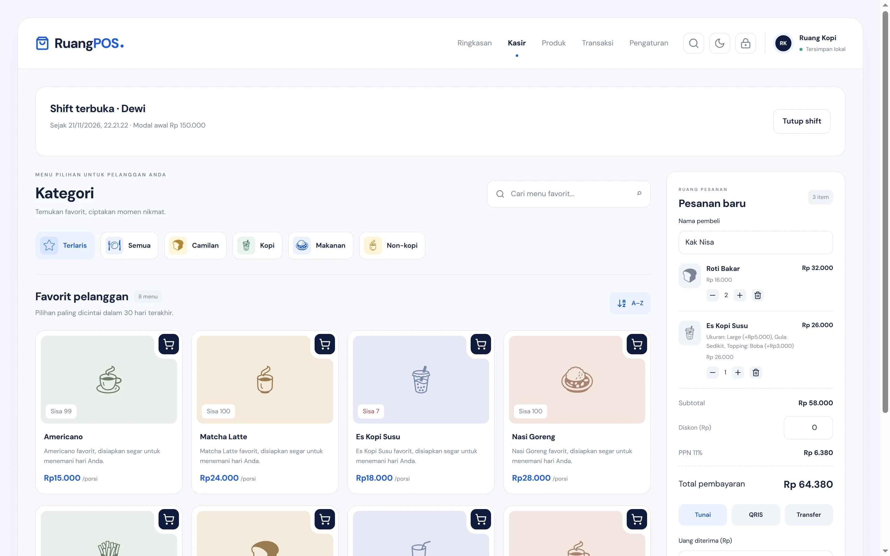
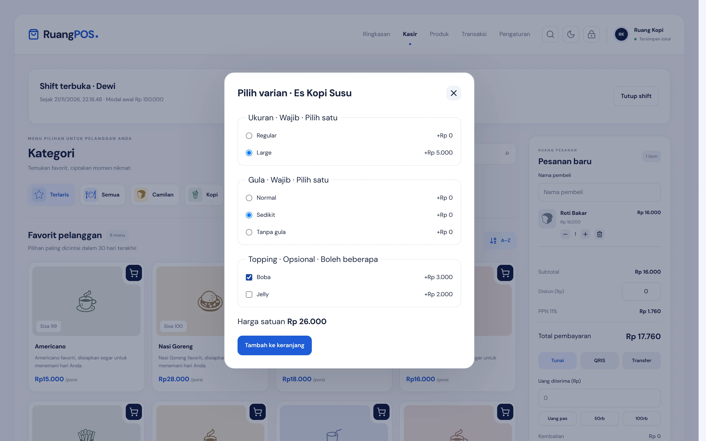
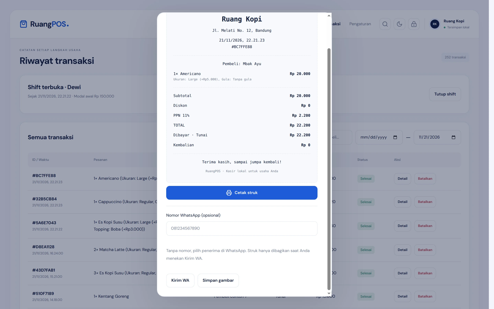
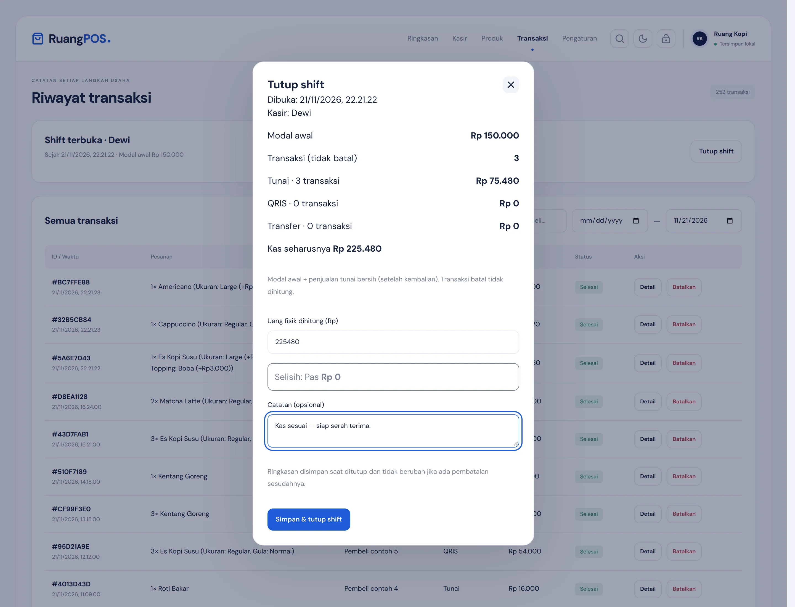
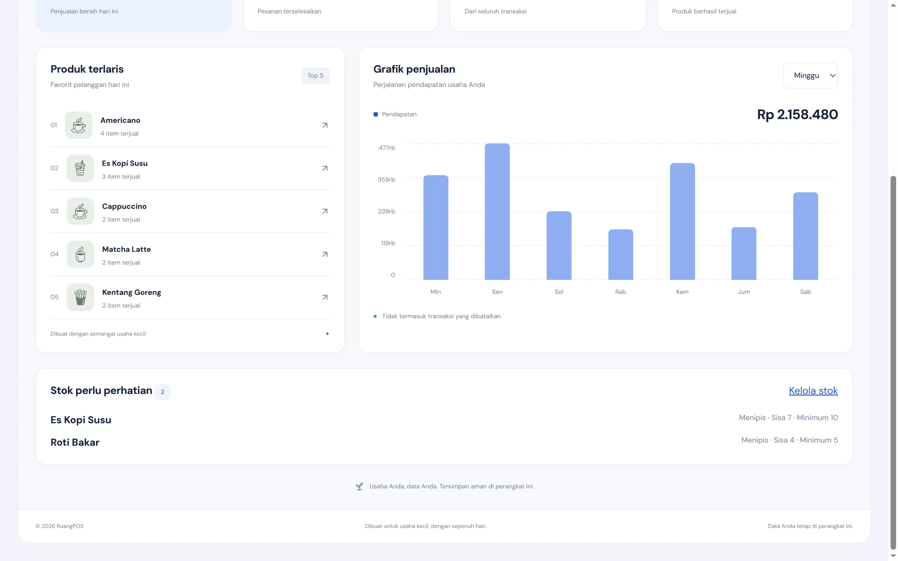
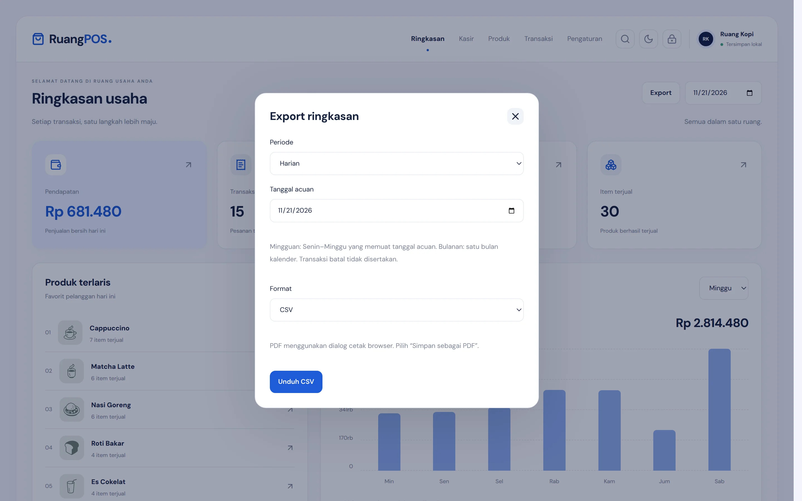
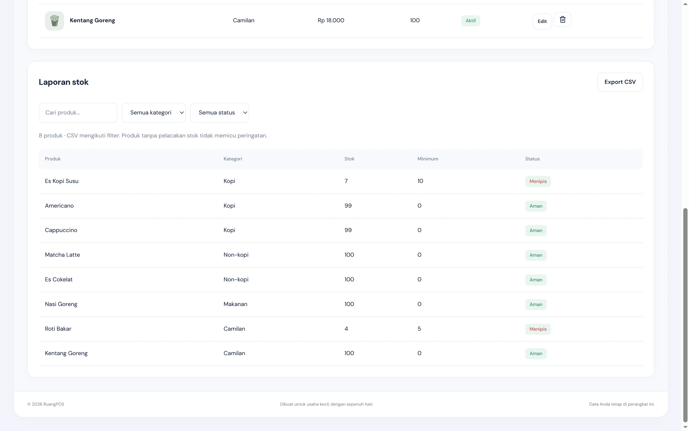
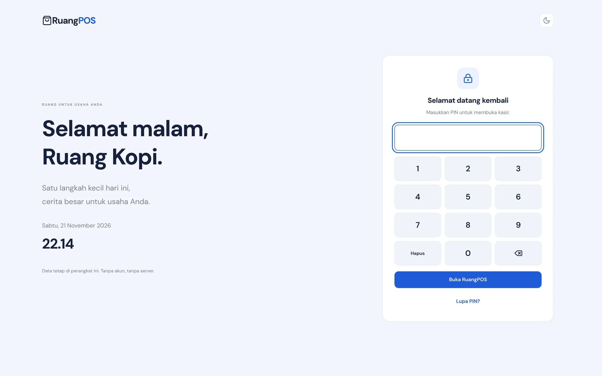
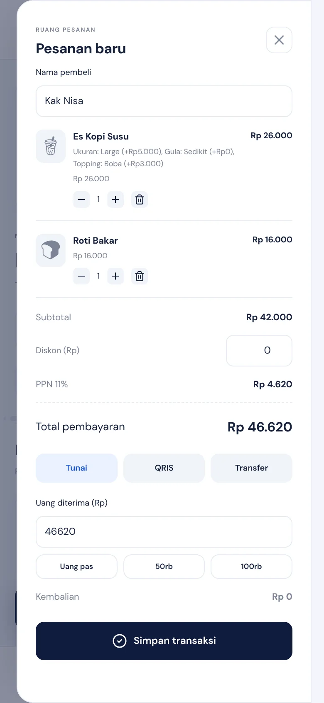

<div align="center">
  
  <h1>RuangPOS</h1>
  <p><strong>Aplikasi kasir gratis, open source, jalan offline — tanpa daftar, tanpa server.</strong></p>
  <p>Ruang sederhana untuk warung, kafe, dan UMKM Indonesia mengelola penjualan sehari-hari.</p>
  <p>
    <a href="LICENSE"></a>
    <a href="https://github.com/iffatazriel/RuangPOS/actions/workflows/ci.yml"></a>
    
    
  </p>
  <p><a href="#coba-sekarang">Coba sekarang</a> · <a href="#fitur">Lihat fitur</a> · <a href="#self-host">Self-host</a> · <a href="#kontribusi">Ikut berkontribusi</a></p>
</div>



## Kenapa RuangPOS?

- **Langsung jualan.** Buat PIN, masukkan produk atau coba data contoh, buka shift, lalu catat pesanan.
- **Tidak bergantung koneksi.** Setelah dibuka online untuk menyimpan aset aplikasi, kasir dapat berjalan offline.
- **Tidak ada biaya langganan.** Kode terbuka; gunakan sendiri atau host sebagai situs statis.
- **Bahasa sehari-hari.** Antarmuka Bahasa Indonesia, harga Rupiah bulat, dan CSV yang cocok untuk Excel Indonesia.
- **Data di tangan Anda.** Tidak perlu akun atau backend; ekspor cadangan usaha dari perangkat sendiri.
- **Nyaman di meja maupun genggaman.** Tata letak responsif, keranjang drawer di ponsel, serta tema terang/gelap.

## Fitur

Semua gambar di bawah menggunakan **data contoh**, bukan data usaha sungguhan. Klik gambar untuk melihat detail.

<table>
  <tr>
    <td width="50%" valign="top"><a href="docs/screenshots/kasir.webp"></a><br /><strong>Kasir untuk penjualan harian</strong><br />Kategori, pencarian, urutan menu, foto/emoji, nama pembeli, diskon Rupiah, PPN 11% opsional, dan kembalian Tunai.</td>
    <td width="50%" valign="top"><a href="docs/screenshots/varian.webp"></a><br /><strong>Varian & tambahan</strong><br />Grup wajib/opsional dan pilihan tunggal/jamak. Pilihan sama bergabung; pilihan berbeda tetap memakai stok produk yang sama.</td>
  </tr>
  <tr>
    <td valign="top"><a href="docs/screenshots/struk.webp"></a><br /><strong>Struk yang mudah dibagikan</strong><br />Cetak, kirim teks ke WhatsApp, atau buat PNG lokal. Rincian pembeli, varian, PPN, dan rekening transfer tersimpan pada transaksi.</td>
    <td valign="top"><a href="docs/screenshots/tutup-shift.webp"></a><br /><strong>Buka & tutup shift</strong><br />Modal awal, kasir, total per metode, kas seharusnya, uang fisik, dan selisih. Riwayat menyimpan snapshot tutup shift yang dapat dicetak.</td>
  </tr>
  <tr>
    <td valign="top"><a href="docs/screenshots/ringkasan.webp"></a><br /><strong>Ringkasan usaha</strong><br />Pendapatan, jumlah transaksi, rata-rata, item terjual, produk terlaris, grafik 7/30 hari, dan peringatan stok menipis.</td>
    <td valign="top"><a href="docs/screenshots/export.webp"></a><br /><strong>Laporan siap dibawa</strong><br />Export harian, mingguan, atau bulanan ke CSV UTF-8 dengan BOM/pemisah titik koma, atau cetak laporan A4 dan Simpan sebagai PDF.</td>
  </tr>
  <tr>
    <td valign="top"><a href="docs/screenshots/laporan-stok.webp"></a><br /><strong>Produk & stok</strong><br />Kategori, foto, deskripsi, stok opsional, dan batas minimum. Filter laporan stok menurut nama/kategori/status, lalu export hasilnya ke CSV.</td>
    <td valign="top"><a href="docs/screenshots/beranda.webp"></a><br /><strong>Beranda & PIN</strong><br />PIN 6 digit, kunci manual, jeda setelah percobaan salah, dan kunci otomatis setelah 15 menit tanpa aktivitas. PIN adalah kunci UI, bukan enkripsi.</td>
  </tr>
</table>

Juga tersedia: pengelolaan rekening dan gambar QRIS, riwayat transaksi dengan pencarian nama pembeli, pembatalan transaksi, backup/impor JSON termasuk gambar/shift/varian, data contoh 30 hari, dan instalasi PWA.

<details>
<summary><strong>Galeri tampilan — desktop & ponsel</strong></summary>

### Beranda


### Kasir


### Varian & tambahan


### Struk & berbagi


### Ringkasan & peringatan stok


### Laporan stok


### Tutup shift


### Export ringkasan


### Keranjang di ponsel


</details>

## Coba sekarang

> **TODO URL demo:** `https://ruangpos.example` — placeholder, **belum situs demo aktif**. Pengelola dapat menggantinya setelah deployment tersedia.

### Jalankan di perangkat sendiri

Siapkan **Node.js 22** dan npm:

```sh
git clone https://github.com/iffatazriel/RuangPOS.git
cd RuangPOS
npm ci
npm run dev
```

Buka `http://localhost:5173`, lalu:

1. Buat PIN 6 digit dan ulangi untuk konfirmasi.
2. Tambahkan produk sendiri, atau pilih **Pengaturan → Isi data contoh**. Data contoh mengganti data usaha yang ada; jangan gunakan pada data sungguhan tanpa backup.
3. Atur nama usaha, PPN, gambar QRIS, dan rekening jika diperlukan.
4. Di **Kasir**, buka shift dengan modal awal. Pilih produk/varian, isi nama pembeli, pilih metode, dan simpan transaksi.
5. Saat selesai, **Tutup shift**, hitung uang fisik, lalu ekspor cadangan JSON.

**Penting tentang pembayaran:** Tunai, QRIS, dan Transfer adalah **pencatatan manual**, bukan payment gateway. Tidak ada verifikasi dana otomatis. Periksa penerimaan dana sebelum menyimpan. QRIS/Transfer memerlukan gambar/rekening yang diatur terlebih dahulu.

### Pasang sebagai aplikasi

Gunakan alamat HTTPS atau localhost. Di Chrome/Edge pilih **Install aplikasi**; di Safari iPhone pilih **Bagikan → Tambahkan ke Layar Utama**. Buka sekali saat online agar aset aplikasi tersedia offline. WhatsApp dan tujuan berbagi eksternal tetap memerlukan koneksi/aplikasi yang sesuai.

## Catatan operasional

- Hanya **satu shift terbuka**; setiap transaksi baru wajib memiliki shift. Kas seharusnya = modal awal + total penjualan Tunai bersih, tidak termasuk transaksi batal.
- Snapshot tutup shift tidak berubah saat transaksi dibatalkan sesudahnya; detail shift memberi catatan. Statistik penjualan mengikuti pembatalan. Transaksi lama tanpa shift tetap terbaca.
- Nama/harga varian dan rekening disalin ke transaksi, sehingga perubahan katalog/pengaturan tidak mengubah rincian transaksi lama.
- Stok nol berstatus **Habis**. Stok positif ≤ minimum berstatus **Menipis**. Tanpa minimum, ambangnya nol; produk tanpa pelacakan stok tidak memicu peringatan. Harga modal belum tersedia, jadi laporan tidak menghitung nilai stok berdasarkan biaya.
- Struk mendukung cetak 80 mm; sesuaikan skala untuk printer 58 mm. PNG dibuat dengan canvas lokal; berbagi berkas memakai menu sistem jika didukung, selain itu diunduh. Nomor WA opsional; awalan `08` menjadi `628`.

## Self-host

RuangPOS tidak memerlukan API, database server, atau akun layanan. Data pelanggan tetap berada di browser yang mengakses aplikasi, **bukan** di host/container.

### Build statis

```sh
npm ci
npm run build
npm run preview -- --port 4173
```

Deploy **isi `dist/`** melalui HTTPS. Konfigurasi saat ini mengasumsikan aplikasi berada di **root domain**, bukan subpath. Semua route aplikasi perlu diarahkan kembali ke `index.html` agar tautan langsung seperti `/kasir` bekerja.

| Host | Konfigurasi dasar |
| --- | --- |
| **Cloudflare Pages** | Build `npm run build`, output `dist`, Node 22. Gunakan penanganan SPA/fallback ke `index.html`. |
| **Vercel** | Preset Vite, output `dist`; tambahkan rewrite route aplikasi ke `/index.html`. |
| **Netlify** | Build `npm run build`, publish `dist`; tambahkan aturan SPA `/* /index.html 200` pada `_redirects` di hasil deployment. |
| **GitHub Pages** | Gunakan situs root (`username.github.io`) atau custom domain. Untuk tautan langsung, sediakan `404.html` salinan `index.html`. Project Pages pada `/RuangPOS/` **belum didukung konfigurasi default**; perlu penyesuaian base Vite, basename router, dan URL manifest/service worker. |

Aturan khusus host di atas adalah petunjuk konfigurasi, bukan berkas deployment yang sudah disertakan. Setelah deploy, periksa reload pada `/kasir`, instalasi PWA, dan akses offline. Tidak ada sinkronisasi data antar-domain atau browser.

### Docker

```sh
docker build -t ruangpos .
docker run --rm -p 8080:80 ruangpos
```

Buka `http://localhost:8080`. Image menggunakan build Node dan Nginx dengan SPA fallback. Untuk akses non-lokal, gunakan reverse proxy HTTPS. Container tidak menjadi tempat penyimpanan transaksi; backup tetap dilakukan dari browser pengguna.

## Privasi & data

- **IndexedDB lokal:** produk, gambar, transaksi, shift, dan pengaturan tersimpan di browser/perangkat itu. Setiap browser dan origin memiliki data terpisah; belum ada sinkronisasi cloud.
- **PIN bukan enkripsi:** disimpan sebagai hash SHA-256 dengan salt acak, tetapi hanya mengunci antarmuka. Orang yang menguasai perangkat atau devtools dapat mengakses data lokal. Reload/tab baru meminta PIN lagi.
- **Backup rutin:** ekspor JSON melalui Pengaturan, simpan di lokasi aman. Menghapus data browser, mode privat, atau kehilangan perangkat dapat menghilangkan data usaha. Impor mengganti data usaha setelah konfirmasi, tetapi tidak mengganti PIN perangkat; hash PIN tidak diekspor.
- **Lupa PIN:** reset hanya dengan menghapus seluruh data setelah mengetik `HAPUS`. Amankan cadangan sebelum masalah terjadi.
- **Berbagi atas pilihan Anda:** struk dikirim ke layanan luar hanya ketika Anda memilih WA/menu berbagi. Cadangan berisi informasi pembeli, rekening, dan QRIS; jangan unggah data usaha asli ke issue atau repositori.

## Tech stack

**React 19 · TypeScript strict · Vite · Tailwind CSS v4 · React Router · Dexie/IndexedDB · vite-plugin-pwa · Vitest · Lucide · DM Sans & Noto Emoji lokal.**

Tidak ada library chart atau layanan pembuat struk eksternal. Uang disimpan sebagai integer Rupiah; PPN dibulatkan setelah diskon. Skema Dexie berversi untuk migrasi, dan backup lama tetap divalidasi secara kompatibel.

```text
src/pages/       Halaman dan alur kerja
src/components/  Komponen UI yang dapat dipakai ulang
src/hooks/       Data live, foto, responsivitas, dan penguncian
src/lib/         Database, uang, laporan, varian, stok, struk, PIN, dan tes murni
public/          Ikon PWA
docs/screenshots/ Galeri dokumentasi (data contoh)
```

## Roadmap

Belum tersedia; arah pengembangan yang dapat didiskusikan bersama:

- [ ] Sinkronisasi multi-device dengan pilihan privasi dan model konflik yang jelas.
- [ ] Pemindaian barcode untuk pencarian produk lebih cepat.
- [ ] Multi-user, peran, dan otorisasi kasir/pemilik.

## Kontribusi

Issue, ide UX untuk UMKM, dokumentasi, dan pull request sangat diterima. Diskusikan perubahan besar terlebih dahulu; fork repositori dan buat branch fitur. Pertahankan Bahasa Indonesia, akses offline, aksesibilitas, dan privasi lokal.

Tambahkan unit test untuk logika baru di `src/lib/`, jaga komponen tetap kecil, dan perbarui dokumentasi/migrasi bila format data berubah. Sebelum mengirim PR:

```sh
npm run typecheck
npm run lint
npm test
npm run build
```

Periksa juga alur yang berubah pada desktop/ponsel dan kedua tema. Gunakan data contoh, bukan data pelanggan sungguhan. CI menjalankan lint, typecheck, test, dan build pada push/PR.

## Dukung RuangPOS

Jika RuangPOS membantu usaha Anda, bantu pengembangan lewat laporan bug, kontribusi kode/dokumentasi, atau donasi. Aplikasi tetap dapat digunakan tanpa donasi.

<!-- TODO: ganti URL donasi resmi dan selaraskan src/lib/config.ts serta .github/FUNDING.yml. -->
[](https://saweria.co/toolsman)


## Lisensi

RuangPOS berlisensi **GNU Affero General Public License v3.0 (AGPL-3.0)**. Penggunaan, distribusi, dan modifikasi mengikuti ketentuan [LICENSE](LICENSE), termasuk kewajiban kode sumber yang berlaku untuk versi modifikasi yang digunakan melalui jaringan.
